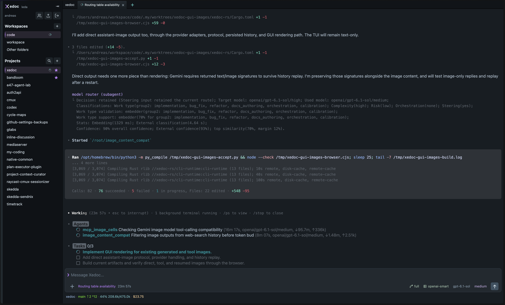
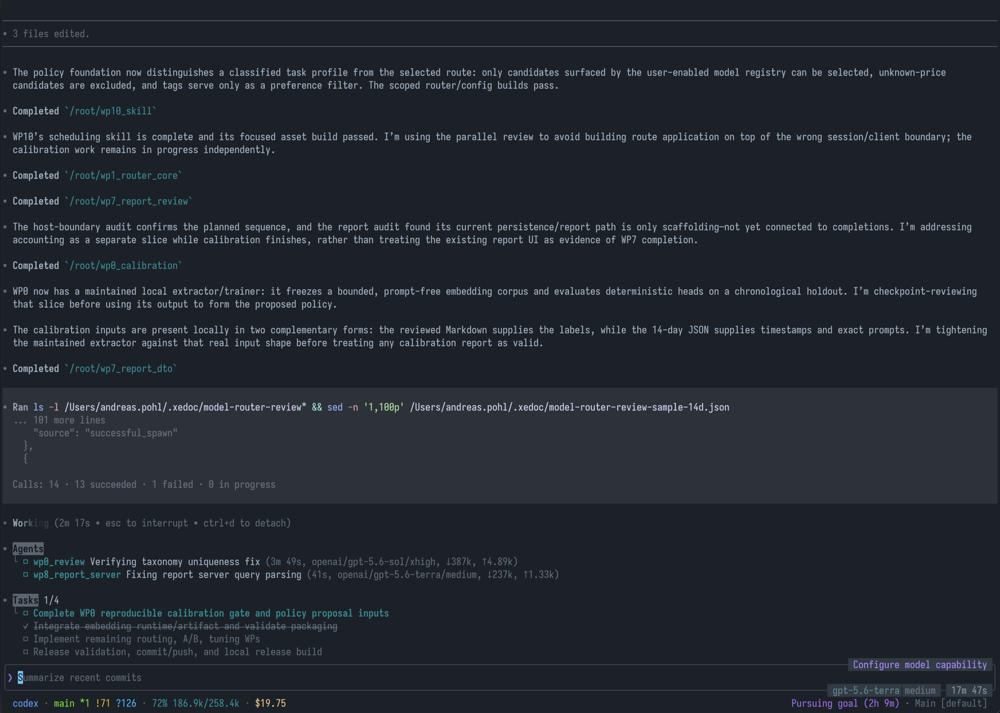

# Xedoc

Xedoc is a personal, experimental coding-agent harness built on OpenAI Codex.
Use it in the terminal or browser, choose models across providers, and coordinate
agents on your machine or remote Xedoc hosts.



## Highlights

- **Remote hosts and agent scheduling** — discover Xedoc hosts on the local
  network, pair trusted machines, and delegate work to their approved workspaces.
  Start, monitor, message, steer, and cancel remote sessions through scoped grants.
- **Multi-backend model routing** — use OpenAI, Anthropic, Gemini, and compatible
  backends. Route root turns and subagent tasks to a provider, model, and reasoning
  effort with a configurable routing script, visible decisions, shadow modes,
  and A/B comparisons.
- **TUI and browser GUI** — work in either interface and switch between running
  sessions on the fly, even during a turn, without stopping their work. The GUI
  adds workspace and project navigation with session tabs.
- **Cross-provider agent teams** — give child agents different providers, models,
  and reasoning efforts. Send messages and follow-up tasks, monitor live activity,
  and control delegation depth.
- **Hot plugin and skill reloads** — pick up plugin and skill changes without
  restarting Xedoc. Plugin updates refresh loaded-session configuration and
  capabilities, including MCP tools.
- **Live cost and token visibility** — track session usage, including active
  child agents, with provider-specific USD pricing and routing reports. Models
  without configured prices remain unestimated.
- **Recoverable tool-output reduction** — reduce verbose tool output before it
  reaches the model, keep full originals on disk for retrieval, and track token
  savings.
- **Persistent plugin context** — plugins can contribute role-aware instructions
  before or after repository guidance, with optional conditions. Child agents
  inherit the thread's plugin context.
- **Visible progress and terminal controls** — keep agents and task checklists
  above the prompt, with automatic session names, filesystem path completion,
  and configurable status lines.

## Terminal UI



## Install

```shell
curl -fsSL https://raw.githubusercontent.com/apohl79/codex/main/scripts/install/install.sh | sh
```

## Project resources

- [Feature inventory](README.fork.md)
- [Contributing](docs/contributing.md)
- [License](LICENSE)
